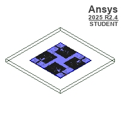
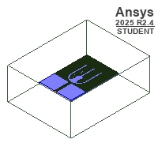

# Ku-Band MIMO Microstrip Antenna

An Ansys HFSS project containing a four-port MIMO antenna design and a single-element companion model. The repository preserves the supplied design, setup, report definitions, and embedded native geometry, with temporary machine-path metadata sanitized for publication.

## Design previews

| MIMO design | Single element |
| --- | --- |
|  |  |

These are the previews embedded in the supplied project, not newly generated simulation results. The original Student-edition markings are retained.

## Project configuration

The following values were read from the project file; they are settings, not validated performance claims.

| Item | Stored configuration |
| --- | --- |
| Project format | Ansys Electronics Desktop, Student 2025 R2 |
| Designs | `MIMO` and `Single element` |
| Solution type | HFSS Terminal Network |
| Adaptive solution frequency | 16.5 GHz |
| Frequency sweep | 8.25–24.75 GHz, 401 points, Fast |
| Project-defined dielectric | Melinex: relative permittivity 2.9; loss tangent 0.06 |
| Saved report definitions | S-parameters, isolation, transmission, ECC/DG, MEG, TARC, CCL, gain, and directivity |

The configured sweep extends beyond the Ku band. It does **not** establish the antenna's usable bandwidth, matching, isolation, efficiency, or gain. The saved output-variable expressions have not been independently checked.

## Open the project

1. Obtain a compatible Ansys Electronics Desktop installation with HFSS and an appropriate license. The saved file identifies Student 2025 R2; compatibility with other versions or editions is unverified.
2. Open [`Ku-Band MIMO Microstrip Antenna.aedt`](Ku-Band%20MIMO%20Microstrip%20Antenna.aedt).
3. Inspect both designs, material assignments, boundaries, excitations, and analysis settings before solving.
4. Validate and solve locally to regenerate results. The upload did not include a separate solved-results directory, and the project references generated cache headers that were not supplied as separate files.

## Contents

```text
Ku-Band MIMO Microstrip Antenna.aedt  Native project with embedded geometry
*-preview.jpg                        Original embedded geometry previews
NOTICES.md                           Provenance and publication notes
```

## Verification status

The source archive passed CRC checks. The publication copy was checked for common credential and private-path patterns, and its embedded binary block length and text-block structure were checked. Two temporary host-path fields were replaced with equal-length neutral metadata; the geometry payload and the rest of the project bytes are unchanged.

**The project was not opened in HFSS and no simulation was run.** These checks do not establish that the edited file loads successfully, that the design converges, or that the antenna meets any specification.

No open-source license was inferred or added. See [NOTICES.md](NOTICES.md).
